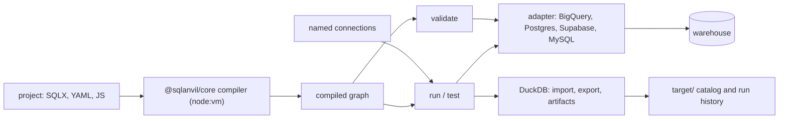

<!-- Format: references/prd-format.md, "prd.md sections". -->
<!-- The first approval goes through the prd-toolkit:authoring-prds skill (phase 7 gates); every later change and approval goes through prd-toolkit:changing-prds (step 5). -->

# sqlanvil

## 1. Metadata & stack

- Language: TypeScript 5.5.4 on Node.js 24.13.0 (the Node toolchain Bazel downloads, `MODULE.bazel`)
- Framework: Bazel 7.3.2 with bzlmod, rules_js 2.0.1 and rules_ts 3.0.0 over a pnpm 9.7.1 lockfile; protobuf for the compiled graph and the config schema (`protos/`)
- Database: none of its own. sqlanvil compiles to and runs against the user's warehouse: BigQuery, PostgreSQL, Supabase or MySQL/MariaDB. DuckDB is bundled for file imports and exports and for the queryable artifacts under `target/`.
- Hosting: none. It ships as the npm packages `@sqlanvil/cli` and `@sqlanvil/core` and runs on the user's machine or runner.
- Build backend: Bazel; `bazel build //packages/@sqlanvil/cli:package_tar //packages/@sqlanvil/core:package_tar` builds the two npm tarballs.
- Package layout: `@sqlanvil/core` (the compiler and action types, from `core/`) and `@sqlanvil/cli` (the command-line interface, from `cli/`), both stamped with `SQLANVIL_VERSION` from `version.bzl`.
- Entry points: the `sqlanvil` binary of `@sqlanvil/cli`; in this repository `./scripts/run` (`bazel run //packages/@sqlanvil/cli:bin`).
- Install command: `npm install -g @sqlanvil/cli`
- Repository: https://github.com/SQLAnvil/sqlanvil
- Not used: npm `scripts` in `package.json` (everything runs through Bazel)
- Not applicable: `contracts/openapi.yaml` — sqlanvil has no HTTP API; its interface is the CLI and the `@sqlanvil/core` package
- Not applicable: `contracts/events.md` — sqlanvil publishes and consumes no events and runs no scheduled jobs of its own
- Not applicable: `contracts/permissions.yaml` — the CLI has no roles; it acts with the warehouse credentials the user gives it
- Not applicable: `contracts/config.yaml` — sqlanvil has no deployed settings per environment; a project's `workflow_settings.yaml` is user input, described by requirements

## 2. Summary & goals

sqlanvil is an open-source SQL workflow tool, a fork of Dataform OSS, that compiles a project of SQLX, YAML and JavaScript into a dependency graph of actions and runs it against BigQuery, PostgreSQL, Supabase or MySQL/MariaDB, generating each warehouse's own idiomatic SQL. Beyond transformation it validates the whole graph against the live warehouse without executing it, imports and exports files, reads other warehouses through named connections, runs Python script actions, and writes a queryable catalog of every compile and run.

Goals:

- Every release passes the integration specs of all four adapters (BigQuery, PostgreSQL, Supabase, MySQL/MariaDB) against a real warehouse, and no BigQuery construct (`OPTIONS(...)`, `PARTITION BY`/`CLUSTER BY` in BigQuery's form, `NOT ENFORCED`, BigQuery's `MERGE`) appears in PostgreSQL, Supabase or MySQL output (owner, 2026-11-22).

Personas: data engineers who build SQL pipelines on PostgreSQL, Supabase or MySQL/MariaDB and may never have used BigQuery, and BigQuery users of Dataform OSS (A-01, confirmed by the owner 2026-11-22).

Out of scope: OpenLineage emission (a standing won't-build, `version.bzl`); the hosted runner, which lives in the separate sqlanvil-cloud repository; column-level lineage and a graph view in `sqlanvil docs`; the VS Code extension, which lives in the separate SQLAnvil/vscode-sqlanvil-tools repository (A-02, confirmed by the owner 2026-11-22; upstream Dataform's copy under `vscode/` was removed in the 3.1.6–3.1.8 upstream sync, SQLAnvil/sqlanvil#67).

Principles:

- **Each warehouse gets its own SQL.** An adapter generates its warehouse's idiomatic DDL and DML; no BigQuery construct (`OPTIONS(...)`, `CLUSTER BY`, `NOT ENFORCED`) appears in PostgreSQL, Supabase or MySQL output.
- **Compile is hermetic.** Compiling a project never runs a Python script action, so a pinned release compiles the same project the same way wherever it runs.
- **Secrets stay out of project files.** Connection secrets live in the git-ignored `.df-credentials.json`, never in the committed `workflow_settings.yaml`.
- **SQLAnvil, not Dataform.** New code, packages and output carry the SQLAnvil name; Dataform appears only for history, upstream links and legal attribution.

## 3. Glossary

| Term | Meaning | Banned synonyms |
|---|---|---|
| SQLAnvil | This product: the `sqlanvil` CLI and the `@sqlanvil/*` packages | Dataform (the upstream it was forked from; the rename is mandatory, CLAUDE.md) |
| project | A directory of SQLX, YAML and JavaScript files with a `workflow_settings.yaml`, compiled and run by sqlanvil | none |
| action | One node of a project's graph: a table, incremental table, view, assertion, operation, declaration, import, export, script or one of the Supabase action types | none |
| SQLX | SQL with a `config { … }` block, the main authoring format for actions | none |
| warehouse | The database a project writes to, named by the flat `warehouse:` setting: `bigquery`, `postgres`, `supabase` or `mysql` | none |
| adapter | The code that turns compiled actions into one warehouse's SQL and runs it (`cli/api/dbadapters/`) | none |
| compiled graph | The protobuf output of `sqlanvil compile`: every action with its SQL and dependencies | none |
| named connection | A source warehouse declared under `connections:`, read through the FDW bridge or by runner-extract | none |
| shadow schema | The timestamped namespace `sqlanvil validate` builds empty stub tables in, dropped after the run | none |
| artifacts | The Parquet catalog and run history sqlanvil writes under `target/` | none |
| catalog | The three artifact files `target/catalog/actions.parquet`, `target/catalog/dependencies.parquet` and `target/catalog/columns.parquet`, rewritten by every compile and run that writes artifacts | none |
| run history | The artifact files `target/runs/run_<run id>.parquet`, one per run, kept until the user deletes them | none |
| named environment | A set of schema suffixes and variables chosen with `--environment` | none |

## 4. Architecture

A project's files are compiled by `@sqlanvil/core`, evaluated inside Node's `node:vm`, into the compiled graph. The CLI runs that graph through the adapter of the project's warehouse, which generates the warehouse's SQL and executes it. `validate` runs the same graph through the warehouse's planner in a shadow schema instead. DuckDB moves files in and out and writes the artifacts.

## 5. Standards registry

| Object (glob) | Linter command | Rules live in | Applies to | Decision |
|---|---|---|---|---|
| `**/*.ts` | `scripts/bazel-ci run //:eslint -- '**/*.ts'` (run by `scripts/lint`, which first installs node_modules and builds the generated sources, locally and in the repository's own `lint` GitHub Actions workflow, added in the 3.1.6–3.1.8 upstream sync; not a prd-toolkit CI job, E-009) | `eslint.config.js`, `eslint-rules/` | code | declined |
| `**/*.ts` | `scripts/bazel-ci run //:prettier -- --ignore-path .prettierignore --check` (every tracked .ts file in CI; `scripts/lint` checks every .ts file too, since the 3.1.6–3.1.8 upstream sync; `.prettierignore` leaves out the generated characterization suites under `tests/prd/`, E-010) | `.prettierrc`, `.prettierignore` | code | enforced |
| `cli/README.md` | `scripts/bazel-ci test //cli:readme_generated_test` (a unit-level target, so the unit level already runs it; not a separate CI job, E-011) | `cli/` command and option definitions | code | declined |

## 6. Skills registry

| Object or activity | Skill | Decision |
|---|---|---|
| planning a change | `superpowers:writing-plans` | required |
| writing code | `superpowers:test-driven-development` | required |
| diagnosing a failure | `superpowers:systematic-debugging` | required |
| reviewing a change | `code-review` | recommended |
| reviewing project-code evaluation and credential handling | `security-review` | recommended |

## 7. Contract types

| Type | Files (glob) | Validator |
|---|---|---|
| schema | `contracts/schema.sql` | built-in |
| errors | `contracts/errors.yaml` | built-in |
| classification | `contracts/data-classification.yaml` | built-in |
| dependencies | `contracts/dependencies/*.yaml` | built-in |
| fixtures | `contracts/fixtures/**` | built-in |

Each external service gets its `contracts/dependencies/` file when the area that calls it is adopted: the BigQuery API (bigquery, sources), PostgreSQL (postgres), MySQL/MariaDB (mysql, sources), the npm registry for the stateless core install (packaging), S3 and GCS (files). None exists yet, because the artifacts area calls no external service. `contracts/data-classification.yaml` stays: it classifies the artifact columns now, and the credentials in `.df-credentials.json` when an area that reads them is adopted (owner, 2026-11-22).

## 8. Adoption map

See adoption.md.

## 9. Versioning

- Version scheme: `SQLANVIL_VERSION` in `version.bzl` is sqlanvil's own SemVer line and the published `@sqlanvil/*` version; `DF_VERSION` is the upstream Dataform release the fork is synced to, shown as metadata (`sqlanvil --version`) only.
- Upstream citations: behaviour inherited unchanged from Dataform OSS is recorded as requirements whose `Source:` cites the upstream file in `dataform-co/dataform` at the tag named by `DF_VERSION` (today `3.1.8`), the release the fork is synced to; an upstream sync moves the cited tag with it (decided on SQLAnvil/sqlanvil#63, tag chosen by the owner 2026-11-22; moved from `3.1.5` to `3.1.8` by the sync on SQLAnvil/sqlanvil#67).
- Compatibility: the CLI requires a `@sqlanvil/core` with the same major version and at least the CLI's `major.minor.0`.
- Breaking for the CLI: a removed or renamed command or flag, a changed exit code, or a changed field in `--json` output. Human-readable text output may change in a minor release (owner, 2026-11-22).
- Breaking for projects: a `workflow_settings.yaml` key, an action config key or an `actions.yaml` key that is removed or changes meaning, so a project that compiled before fails or behaves differently. A new optional key is not breaking (owner, 2026-11-22).
- Breaking for compiled SQL: a change that leaves different tables, columns or rows in the warehouse for the same project and data. A rewrite with the same results (formatting, an equivalent statement) is not breaking (owner, 2026-11-22).
- Compatibility window: a removed or changed behaviour first prints a deprecation warning for at least one minor release, and is removed no earlier than the next major (owner, 2026-11-22).
- Migration rule: each deprecation and each breaking change is named in the release notes (`docs/whats-new.md` in sqlanvil-com); `sqlanvil migrate-fix` rewrites what it can, and `sqlanvil migrate-dataform` brings projects over from Dataform (owner, 2026-11-22).

## 10. Design & UI

The CLI's interface is its commands, flags and output, documented in `cli/README.md` (generated from the definitions in `cli/`). `sqlanvil docs` renders a self-contained HTML catalog to `target/docs/index.html`. The VS Code extension is not specified by this PRD: the maintained extension is the separate SQLAnvil/vscode-sqlanvil-tools repository (owner, 2026-11-22). Upstream Dataform's extension under `vscode/`, once kept for upstream syncs, was removed in the 3.1.6–3.1.8 upstream sync (SQLAnvil/sqlanvil#67).

## 11. Requirement index

| ID | Title | Status | File | Since |
|---|---|---|---|---|
| UJ-01 | Explore a project's catalog and last run | live | features/artifacts.md | 1.0.0 |
| FR-001 | Write the catalog Parquet files | verified | features/artifacts.md |  |
| FR-002 | Shape one catalog row per action | live | features/artifacts.md | 1.0.0 |
| FR-003 | Shape one dependency row per dependency edge | live | features/artifacts.md | 1.0.0 |
| FR-004 | Shape one column row per documented column | live | features/artifacts.md | 1.0.0 |
| FR-005 | Write a run-history Parquet file per run | verified | features/artifacts.md |  |
| FR-006 | Keep the columns of an empty artifact file | verified | features/artifacts.md |  |
| FR-007 | Remove the staging file after a Parquet write | live | features/artifacts.md | 1.0.0 |
| FR-008 | Never fail the caller when artifacts cannot be written | live | features/artifacts.md | 1.0.0 |
| FR-009 | Read the project's artifacts, and refuse without a catalog | live | features/artifacts.md | 1.0.0 |
| FR-010 | Expose the artifacts as DuckDB views | verified | features/artifacts.md |  |
| FR-011 | Run SQL over the artifacts with the query command | verified | features/artifacts.md |  |
| FR-012 | Print query results as JSON | live | features/artifacts.md | 1.0.0 |
| FR-013 | Require SQL for the query command | live | features/artifacts.md | 1.0.0 |
| FR-014 | Return 64-bit integers as JSON-safe values | live | features/artifacts.md | 1.0.0 |
| FR-015 | Open a fresh in-memory DuckDB for each artifact query | live | features/artifacts.md | 1.0.0 |
| FR-016 | Redirect DuckDB's home directory when HOME is unset | live | features/artifacts.md | 1.0.0 |
| FR-017 | Report a DuckDB binding that fails to load | live | features/artifacts.md | 1.0.0 |
| FR-018 | Summarize the artifacts with the inspect command | verified | features/artifacts.md |  |
| FR-019 | Print the inspect summary as JSON | verified | features/artifacts.md |  |
| FR-020 | Write the HTML catalog with the docs command | live | features/artifacts.md | 1.0.0 |
| FR-021 | Build the docs catalog model from the artifacts | verified | features/artifacts.md |  |
| FR-022 | Render the docs catalog as one self-contained HTML page | live | features/artifacts.md | 1.0.0 |
| FR-023 | Run a warehouse query through an adapter | live | features/artifacts.md | 1.0.0 |
| FR-024 | Evaluate a query through an adapter | live | features/artifacts.md | 1.0.0 |

## 12. Assumptions index

| ID | Assumption | Status |
|---|---|---|
| A-01 | Personas: data engineers on PostgreSQL, Supabase or MySQL/MariaDB who may never have used BigQuery, and BigQuery users of Dataform OSS | confirmed |
| A-02 | Out of scope: OpenLineage emission, the hosted runner (sqlanvil-cloud), column-level lineage and a graph view in `sqlanvil docs` | confirmed |
| A-03 | The characterization suite lives under `tests/prd/`, one directory per area, as `ts_test_suite` targets tagged `integration` | confirmed |
| A-04 | Artifact column classes: every column `internal`, except `runs.error_message`, which is `confidential` because warehouse error text can quote data values | confirmed |

## 13. Open questions

None.

## 14. Changelog

| Version | Date | Change | IDs |
|---|---|---|---|
| 0.1.0 | 2026-11-22 | Draft started | none |
| 1.0.0 | 2026-11-23 | Approved; artifacts area adopted; suite all 85 T-ids: 75 pass, T-001.4 and T-010.5 known-failing E-006, T-005.9, T-018.6, T-019.4 and T-021.8 known-failing E-002, T-006.1 known-failing E-003, T-018.5 and T-019.3 known-failing E-001, T-021.7 known-failing E-004; dry run T-001.2, T-020.3, T-019.1, T-014.1, T-008.2: 0 open questions, 1 dismissed by quote | UJ-01, FR-001, FR-002, FR-003, FR-004, FR-005, FR-006, FR-007, FR-008, FR-009, FR-010, FR-011, FR-012, FR-013, FR-014, FR-015, FR-016, FR-017, FR-018, FR-019, FR-020, FR-021, FR-022, FR-023, FR-024 |
| 1.0.1 | 2026-11-23 | Bazel commands in Levels and the standards rows run through scripts/bazel-ci, which creates a missing ~/.npmrc (E-008); no dry run (no T-id changed; harness and linter commands only) | - |
| 1.0.2 | 2026-11-23 | eslint and README rows declined for CI (E-009, E-011), tests/prd left out of prettier (E-010), warehouse level at the deploy gate with the CLI live-BigQuery test (E-012); no dry run (no T-id changed; registry rows and levels only) | - |
| 1.0.3 | 2026-11-24 | upstream 3.1.6-3.1.8 sync (#67): vscode/ removed, DF_VERSION tag 3.1.8, lint now in the repository lint workflow and over every .ts file; no dry run (wording only) | - |
| 1.0.4 | 2026-11-24 | regression test for E-007; dry run T-018.7, T-019.5, 0 open questions, 3 dismissed by quote | FR-018, FR-019, T-018.7, T-019.5 |
| 2.0.0 | 2026-11-25 | run-summary files and run_summary view so a run with no action results is recorded (E-002); dry run T-005.7, T-005.8, T-005.9, T-005.10, T-005.12, T-010.6, T-010.7, T-018.8, 0 open questions, 1 dismissed by quote | UJ-01, FR-005, FR-010, FR-018, FR-019, FR-021, AC-005.7, AC-005.8, AC-005.9, AC-005.10, AC-005.11, AC-010.6, AC-018.2, AC-018.4, AC-019.1, AC-019.2, AC-021.3, AC-021.4, T-005.7, T-005.8, T-005.9, T-005.10, T-005.12, T-010.6, T-010.7, T-018.8 |
| 2.0.1 | 2026-11-25 | test case T-021.8 and the Harness view globs corrected to match AC-021.3 (run_summary view); dry run T-021.8, 0 open questions, 0 dismissed by quote | FR-021, T-021.8 |
| 2.1.0 | 2026-11-25 | contracts/schema.sql (duckdb) declares the artifact views actions, dependencies, columns, runs and run_summary with the columns and types AC-001.2, AC-005.1 and AC-005.11 state, so a linked PRD can cite them; run_summary classified; catalog files named by full path in AC-001.2, AC-010.1, AC-010.4 and the glossary; no dry run (contract and wording only) | FR-001, FR-002, FR-003, FR-004, FR-005, FR-010, AC-001.2, AC-010.1, AC-010.4 |
| 2.2.0 | 2026-11-25 | the query command help names all five views it runs SQL over, as (views: actions, dependencies, columns, runs, run_summary) (AC-011.5; sqlanvil-com E-001); dry run T-011.5, 0 open questions, 2 dismissed by quote | FR-011, AC-011.5, T-011.5 |
