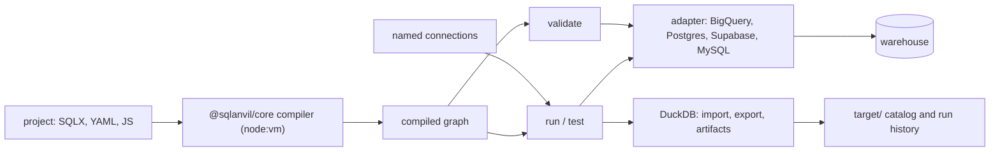

<!-- Format: references/prd-format.md, "prd.md sections". -->
<!-- The first approval goes through the prd-toolkit:authoring-prds skill (phase 7 gates); every later change and approval goes through prd-toolkit:changing-prds (step 5). -->

# sqlanvil

## 1. Metadata & stack

- Language: TypeScript 5.5.4 on Node.js 24.13.0 (the Node toolchain Bazel downloads, `MODULE.bazel`)
- Framework: Bazel 7.3.2 with bzlmod, rules_js 2.0.1 and rules_ts 3.0.0 over a pnpm 9.7.1 lockfile; protobuf for the compiled graph and the config schema (`protos/`)
- Database: none of its own. sqlanvil compiles to and runs against the user's warehouse: BigQuery, PostgreSQL, Supabase or MySQL/MariaDB. DuckDB is bundled for file imports and exports and for the queryable artifacts under `target/`.
- Hosting: none. It ships as the npm packages `@sqlanvil/cli` and `@sqlanvil/core` and runs on the user's machine or runner.
- Build backend: Bazel; `bazel build //packages/@sqlanvil/cli:package_tar //packages/@sqlanvil/core:package_tar` builds the two npm tarballs.
- Package layout: `@sqlanvil/core` (the compiler and action types, from `core/`) and `@sqlanvil/cli` (the command-line interface, from `cli/`), both stamped with `SQLANVIL_VERSION` from `version.bzl`.
- Entry points: the `sqlanvil` binary of `@sqlanvil/cli`; in this repository `./scripts/run` (`bazel run //packages/@sqlanvil/cli:bin`).
- Install command: `npm install -g @sqlanvil/cli`
- Repository: https://github.com/SQLAnvil/sqlanvil
- Not used: npm `scripts` in `package.json` (everything runs through Bazel); [NEEDS CLARIFICATION: other technologies deliberately ruled out]
- Not applicable: `contracts/openapi.yaml` — sqlanvil has no HTTP API; its interface is the CLI and the `@sqlanvil/core` package
- Not applicable: `contracts/schema.sql` — sqlanvil owns no database; the tables it writes belong to the user's project
- Not applicable: `contracts/events.md` — sqlanvil publishes and consumes no events and runs no scheduled jobs of its own
- Not applicable: `contracts/permissions.yaml` — the CLI has no roles; it acts with the warehouse credentials the user gives it
- Not applicable: `contracts/config.yaml` — sqlanvil has no deployed settings per environment; a project's `workflow_settings.yaml` is user input, described by requirements

## 2. Summary & goals

sqlanvil is an open-source SQL workflow tool, a fork of Dataform OSS, that compiles a project of SQLX, YAML and JavaScript into a dependency graph of actions and runs it against BigQuery, PostgreSQL, Supabase or MySQL/MariaDB, generating each warehouse's own idiomatic SQL. Beyond transformation it validates the whole graph against the live warehouse without executing it, imports and exports files, reads other warehouses through named connections, runs Python script actions, and writes a queryable catalog of every compile and run.

Goals:

- [NEEDS CLARIFICATION: first measurable goal]

Personas: [ASSUMPTION A-01: data engineers who build SQL pipelines on PostgreSQL, Supabase or MySQL/MariaDB and may never have used BigQuery, and BigQuery users of Dataform OSS; CLAUDE.md, "Design Directive — Postgres Is First-Class"]

Out of scope: [ASSUMPTION A-02: OpenLineage emission (a standing won't-build, `version.bzl`); the hosted runner, which lives in the separate sqlanvil-cloud repository; column-level lineage and a graph view in `sqlanvil docs` (CLAUDE.md, "Queryable artifacts")]

Principles:

- **Each warehouse gets its own SQL.** An adapter generates its warehouse's idiomatic DDL and DML; no BigQuery construct (`OPTIONS(...)`, `CLUSTER BY`, `NOT ENFORCED`) appears in PostgreSQL, Supabase or MySQL output.
- **Compile is hermetic.** Compiling a project never runs a Python script action, so a pinned release compiles the same project the same way wherever it runs.
- **Secrets stay out of project files.** Connection secrets live in the git-ignored `.df-credentials.json`, never in the committed `workflow_settings.yaml`.
- **SQLAnvil, not Dataform.** New code, packages and output carry the SQLAnvil name; Dataform appears only for history, upstream links and legal attribution.

## 3. Glossary

| Term | Meaning | Banned synonyms |
|---|---|---|
| SQLAnvil | This product: the `sqlanvil` CLI and the `@sqlanvil/*` packages | Dataform (the upstream it was forked from; the rename is mandatory, CLAUDE.md) |
| project | A directory of SQLX, YAML and JavaScript files with a `workflow_settings.yaml`, compiled and run by sqlanvil | none |
| action | One node of a project's graph: a table, incremental table, view, assertion, operation, declaration, import, export, script or one of the Supabase action types | none |
| SQLX | SQL with a `config { … }` block, the main authoring format for actions | none |
| warehouse | The database a project writes to, named by the flat `warehouse:` setting: `bigquery`, `postgres`, `supabase` or `mysql` | none |
| adapter | The code that turns compiled actions into one warehouse's SQL and runs it (`cli/api/dbadapters/`) | none |
| compiled graph | The protobuf output of `sqlanvil compile`: every action with its SQL and dependencies | none |
| named connection | A source warehouse declared under `connections:`, read through the FDW bridge or by runner-extract | none |
| shadow schema | The timestamped namespace `sqlanvil validate` builds empty stub tables in, dropped after the run | none |
| artifacts | The Parquet catalog and run history sqlanvil writes under `target/` | none |
| named environment | A set of schema suffixes and variables chosen with `--environment` | none |

## 4. Architecture

A project's files are compiled by `@sqlanvil/core`, evaluated inside Node's `node:vm`, into the compiled graph. The CLI runs that graph through the adapter of the project's warehouse, which generates the warehouse's SQL and executes it. `validate` runs the same graph through the warehouse's planner in a shadow schema instead. DuckDB moves files in and out and writes the artifacts.

## 5. Standards registry

| Object (glob) | Linter command | Rules live in | Applies to | Decision |
|---|---|---|---|---|
| `**/*.ts` | `bazel run //:eslint -- '**/*.ts'` | `eslint.config.js`, `eslint-rules/` | code | proposed |
| `**/*.ts` | `bazel run //:prettier -- --ignore-path .prettierignore --check` (files changed on the branch, `scripts/lint`) | `.prettierrc`, `.prettierignore` | code | proposed |
| `cli/README.md` | `bazel test //cli:readme_generated_test` | `cli/` command and option definitions | code | proposed |

## 6. Skills registry

| Object or activity | Skill | Decision |
|---|---|---|
| planning a change | `superpowers:writing-plans` | proposed |
| writing code | `superpowers:test-driven-development` | proposed |
| diagnosing a failure | `superpowers:systematic-debugging` | proposed |
| reviewing a change | `code-review` | proposed |
| reviewing project-code evaluation and credential handling | `security-review` | proposed |

## 7. Contract types

| Type | Files (glob) | Validator |
|---|---|---|
| errors | `contracts/errors.yaml` | built-in |
| classification | `contracts/data-classification.yaml` | built-in |
| dependencies | `contracts/dependencies/*.yaml` | built-in |
| fixtures | `contracts/fixtures/**` | built-in |

[NEEDS CLARIFICATION: which external services get a `contracts/dependencies/` file (candidates in the code: the BigQuery API, PostgreSQL, MySQL/MariaDB, the npm registry for the stateless core install, S3 and GCS for imports and exports), and whether `contracts/data-classification.yaml` stays, for the credentials in `.df-credentials.json`, or is declared Not applicable]

## 8. Adoption map

See adoption.md.

## 9. Versioning

- Version scheme: `SQLANVIL_VERSION` in `version.bzl` is sqlanvil's own SemVer line and the published `@sqlanvil/*` version; `DF_VERSION` is the upstream Dataform release the fork is synced to, shown as metadata (`sqlanvil --version`) only.
- Compatibility: the CLI requires a `@sqlanvil/core` with the same major version and at least the CLI's `major.minor.0`.
- Breaking for the CLI: [NEEDS CLARIFICATION: what counts as breaking: a removed command or flag, a changed exit code, changed output]
- Breaking for projects: [NEEDS CLARIFICATION: what counts as breaking: a `workflow_settings.yaml` key or an action config key removed or changed in meaning]
- Breaking for compiled SQL: [NEEDS CLARIFICATION: whether a change in the SQL an adapter generates for an unchanged project is breaking]
- Compatibility window: [NEEDS CLARIFICATION: how long old behaviour is kept]
- Migration rule: [NEEDS CLARIFICATION: how changes roll out; `sqlanvil migrate-dataform` and `migrate-fix` exist for projects coming from Dataform]

## 10. Design & UI

The CLI's interface is its commands, flags and output, documented in `cli/README.md` (generated from the definitions in `cli/`). `sqlanvil docs` renders a self-contained HTML catalog to `target/docs/index.html`. [NEEDS CLARIFICATION: is the VS Code extension under `vscode/` part of this PRD, and if so, what it shows]

## 11. Requirement index

| ID | Title | Status | File | Since |
|---|---|---|---|---|
| FR-001 | Write the catalog Parquet files | approved | features/artifacts.md |  |
| FR-002 | Shape one catalog row per action | live | features/artifacts.md | 1.0.0 |
| FR-003 | Shape one dependency row per dependency edge | live | features/artifacts.md | 1.0.0 |
| FR-004 | Shape one column row per documented column | live | features/artifacts.md | 1.0.0 |
| FR-005 | Write a run-history Parquet file per run | approved | features/artifacts.md |  |
| FR-006 | Keep the columns of an empty artifact file | approved | features/artifacts.md |  |
| FR-007 | Remove the staging file after a Parquet write | live | features/artifacts.md | 1.0.0 |
| FR-008 | Never fail the caller when artifacts cannot be written | live | features/artifacts.md | 1.0.0 |
| FR-009 | Read the project's artifacts, and refuse without a catalog | live | features/artifacts.md | 1.0.0 |
| FR-010 | Expose the artifacts as DuckDB views | approved | features/artifacts.md |  |
| FR-011 | Run SQL over the artifacts with the query command | live | features/artifacts.md | 1.0.0 |
| FR-012 | Print query results as JSON | live | features/artifacts.md | 1.0.0 |
| FR-013 | Require SQL for the query command | live | features/artifacts.md | 1.0.0 |
| FR-014 | Return 64-bit integers as JSON-safe values | live | features/artifacts.md | 1.0.0 |
| FR-015 | Open a fresh in-memory DuckDB for each artifact query | live | features/artifacts.md | 1.0.0 |
| FR-016 | Redirect DuckDB's home directory when HOME is unset | live | features/artifacts.md | 1.0.0 |
| FR-017 | Report a DuckDB binding that fails to load | live | features/artifacts.md | 1.0.0 |
| FR-018 | Summarize the artifacts with the inspect command | approved | features/artifacts.md |  |
| FR-019 | Print the inspect summary as JSON | approved | features/artifacts.md |  |
| FR-020 | Write the HTML catalog with the docs command | live | features/artifacts.md | 1.0.0 |
| FR-021 | Build the docs catalog model from the artifacts | approved | features/artifacts.md |  |
| FR-022 | Render the docs catalog as one self-contained HTML page | live | features/artifacts.md | 1.0.0 |
| FR-023 | Run a warehouse query through an adapter | live | features/artifacts.md | 1.0.0 |
| FR-024 | Evaluate a query through an adapter | live | features/artifacts.md | 1.0.0 |

## 12. Assumptions index

| ID | Assumption | Status |
|---|---|---|
| A-01 | Personas: data engineers on PostgreSQL, Supabase or MySQL/MariaDB who may never have used BigQuery, and BigQuery users of Dataform OSS | open |
| A-02 | Out of scope: OpenLineage emission, the hosted runner (sqlanvil-cloud), column-level lineage and a graph view in `sqlanvil docs` | open |
| A-03 | The characterization suite lives under `tests/prd/`, one directory per area, as `ts_test_suite` targets tagged `integration` | open |
| A-04 | Artifact column classes: every column `internal`, except `runs.error_message`, which is `confidential` because warehouse error text can quote data values | open |

## 13. Open questions

- Q-01 Behaviour inherited unchanged from Dataform OSS is recorded as requirements whose `Source:` cites the upstream file at the merge-base with `dataform-co/dataform` (decided on SQLAnvil/sqlanvil#63); which upstream commit is the merge-base to cite?

## 14. Changelog

| Version | Date | Change | IDs |
|---|---|---|---|
| 0.1.0 | 2026-11-22 | Draft started | none |
